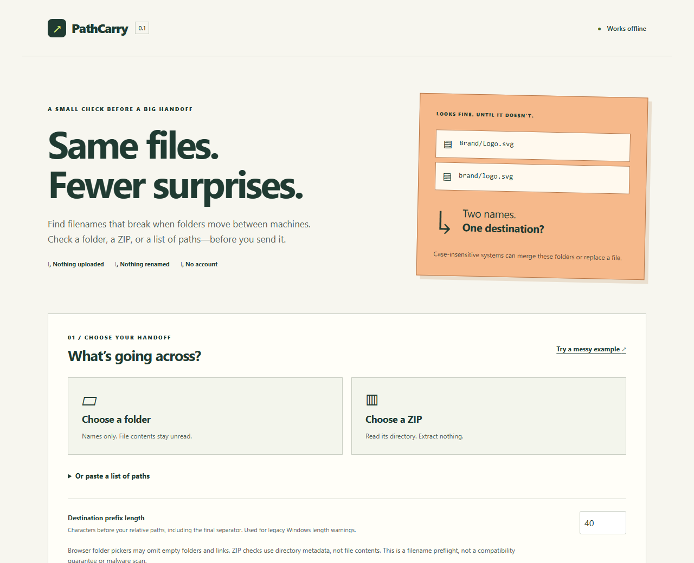

# PathCarry ↗

**Works on my machine. Will the filenames travel?**

Check filenames before a folder or ZIP changes hands. Catch names that Windows rejects, directories that merge when case is ignored, Unicode collisions and paths that become too long. Offline. Read-only. No account.



## Open it. Check it. Send it.

1. Download **[path-carry.html from the latest release](https://github.com/Buzburg/path-carry/releases/latest)**.
2. Open the file in a current desktop Chromium or Firefox browser. An internet connection is unnecessary.
3. Choose a folder or ZIP, or paste a relative path list. Try the built-in messy example first.
4. Review findings and save a readable HTML report or JSON. Fix names in your own tools and check again.

The app does not upload, rename, extract or change your files. Folder checks read names, not contents. ZIP checks read central-directory metadata without decompressing entries. No runtime CDN, server, API key, telemetry or browser storage is used. The source link opens GitHub only when clicked.

**This is a filename preflight, not a compatibility guarantee, archive-integrity check or malware scanner.** Reports contain filenames; review them before sharing.

## What gets caught?

| Example | Finding |
|---|---|
| `CON.pdf`, `AUX`, `COM¹.txt` | Windows-reserved device name |
| `Invoice: July.pdf`, `what?.txt` | Windows-forbidden character |
| `final.txt ` or `folder.` | Trailing space or period |
| `Art/logo.svg` and `art/banner.svg` | Ancestor folders can merge on case-insensitive systems |
| `README.md` and `readme.md` | Case collision |
| Two visually identical accented names with different Unicode forms | Unicode-normalization collision |
| `../outside.txt`, `/absolute`, `a//b` | Unsafe or ambiguous relative path |
| `data` as a file and `data/item.txt` | File/directory conflict |
| Very deep paths or oversized components | Length warning |
| A symbolic link or junction detected by the CLI/ZIP reader | Link warning; target not followed |

Errors identify names or structures that ordinary Windows handoffs cannot reliably represent. Warnings need a destination-specific decision. Comparisons use NFC normalization and JavaScript lowercase; they do not emulate every NTFS, APFS, Linux or cloud-storage policy.

## Command line

Download `path-carry.mjs` from the same release. Requires **Node.js 22 or later**; no install or third-party packages needed at runtime.

```sh
node path-carry.mjs ./client-handoff
node path-carry.mjs --zip ./export.zip --format json
node path-carry.mjs --list ./paths.txt --prefix 60 --format html > report.html
```

Exit status: **0** no findings, **1** findings, **2** invalid input or incomplete check. Reports go to standard output; failure explanations go to standard error. Text reports escape terminal control characters in filenames. JSON uses the versioned `pathcarry/v1` schema. The CLI includes empty directories and does not follow detected symlinks or junctions. Keep the folder unchanged while scanning: the CLI is not a sandbox against another process changing the filesystem concurrently.

In a GitHub workflow, run a verified copy of the CLI after checking out your repository:

```yaml
- name: Check filenames before packaging
  run: node tools/path-carry.mjs ./release-folder --format json > path-report.json
```

A warning also returns status 1, so it blocks this step until reviewed. There is deliberately no automatic rename or unsafe “fix everything” mode.

## Scope and limits

- Browser folder selection may omit empty directories and links. It includes the selected root folder name; CLI paths are relative to the selected root. Set your prefix accordingly.
- A path list uses one slash-separated relative path per line. Spaces are preserved, empty lines ignored, and a final `/` denotes a directory. CLI lists must be regular UTF-8 files (an initial BOM is accepted), at most 8 MB. Use folder/ZIP input for names containing newlines. Keep input files unchanged during a check.
- The destination prefix is the length before each relative path, including its final separator. Default: 40 UTF-16 units. The legacy Windows warning uses 260 including the terminating NUL. Long-path-aware software may accept longer paths.
- ZIP checks support ZIP64 and Unicode names through [zip.js](https://github.com/gildas-lormeau/zip.js). Payloads, local headers, CRCs and link targets are not validated. Visible names in encrypted entries can be checked; encrypted central directories cannot. Ambiguous/nonstandard metadata is rejected. Split archives are unsupported.
- Maximum 20,000 entries, 4,096 characters per path, 2 million input path characters, 100,000 expanded nodes, 8 million expanded path characters and 50,000 findings. ZIP reads are bounded to 16 MiB per read and 32 MiB total. Oversized checks fail explicitly instead of returning a partial clean report.
- Browser work runs in a disposable worker, with cancel and a 30-second timeout. Results display 100 findings at a time; exports include the complete report. Changes to input/settings invalidate old results.
- Tested on Windows and Ubuntu with Chromium and Firefox. Safari and mobile folder-selection behavior are not verified.

## Build and verify

```sh
npm ci --ignore-scripts
npm run typecheck
npm test
npx playwright install chromium firefox
npm run test:browser
```

`npm test` builds `dist/` and checks the core engine, real ZIP metadata and bundled CLI. Browser tests open the actual standalone HTML with network access disabled, exercise downloads and check accessibility. GitHub Actions repeats verification on Node 22 and publishes tagged releases with SHA-256 checksums.

The HTML and CLI embed license notices and are self-contained. Verify downloaded release files against `SHA256SUMS.txt`. Checksums detect accidental changes; they are not a separate signature or proof of publisher identity.

## Why another checker?

Filename portability is an existing problem with existing solutions. PathCarry packages a focused read-only check as one offline HTML file and a CLI using the same engine. Its emphasis is explaining **both file collisions and parent-directory merges** before a handoff. See [research and alternatives](docs/RESEARCH.md), [design](docs/DESIGN.md), [verification](docs/VERIFICATION.md), and [security boundaries](SECURITY.md).

MIT licensed. Includes zip.js under BSD-3-Clause. Built by [Buzburg](https://github.com/Buzburg).

See [release verification](RELEASE_VERIFICATION.md) for the release checks.
